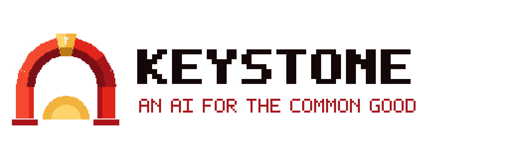

# Keystone

An AI that works for the common good.

Keystone is an open-source, unified network of AI assistants on the same open code and standards: one for a
state, and one for every county, city and town that joins. It carries the philosophy of **Christian Unionism**, which grows
from the dignity of every person, made in the image of God, and from the Church's social teaching: the common
good, solidarity, subsidiarity, care for the poor, the dignity of work, the family, stewardship and care for
creation. Keystone explains and promotes these ideas openly and honestly, connects people, keeps honest shared
records and raises the alarm when people are in need.

The Christian Union Party is an American political party, founded in **Arizona**. It works inside the US Constitution,
seeks office in free elections, and is organizing to become a recognized party in Arizona. In office it would
connect the state's systems so government works as one. It is pro-AI and anti-slop.

This repository is Keystone's brain: its identity, principles, memory, skills and governance, all in plain text
that anyone can read and the people can change. It also holds Keystone's look and sound: the Keystone emblem,
the Guild typeface and the thirteen-track rock soundtrack *Stone by Stone*, made with Vigil Sprite and Vigil Box.
Its public home is [ChristianUnion.party](https://christianunion.party), whose source is in [site/](site/).

## Start here

- [THE-CHRISTIAN-UNIONIST-MANIFESTO.md](THE-CHRISTIAN-UNIONIST-MANIFESTO.md): the full statement of Christian Unionism
- [KEYSTONE.md](KEYSTONE.md): who Keystone is, and the entry point it loads first
- [identity/principles.md](identity/principles.md): the constitution it acts under
- [identity/manifesto.md](identity/manifesto.md): the short version of the philosophy
- [identity/history.md](identity/history.md): the traditions Christian Unionism comes from
- [governance/mandate.md](governance/mandate.md): what Keystone may decide on its own (nothing yet)
- [memory/README.md](memory/README.md): how its shared memory works
- [skills/README.md](skills/README.md): what it knows how to do
- [architecture/viable-system-model.md](architecture/viable-system-model.md): how it is designed
- [architecture/railway.md](architecture/railway.md): how it will run on Railway
- [governance/amendments.md](governance/amendments.md): how to change it
- [LICENSING.md](LICENSING.md): the Keystone License, its scope and earlier permissions
- [assets/BRAND.md](assets/BRAND.md): the emblem, colours, typeface, banners and site art
- [assets/music/](assets/music/README.md): *Stone by Stone*, the official soundtrack
- [site/](site/): the ChristianUnion.party website

## Status

The brain, brand, soundtrack and website are set up. No administrative mandate has been granted, so Keystone
only explains, advises, connects and records. The runtime service that will load it on Railway has not been
built yet.

## Licence

The **Keystone License 1.0** covers the original repository: code, knowledge, identity, skills, art, music,
website and typeface sources. See [LICENSE](LICENSE) for the terms and [LICENSING.md](LICENSING.md) for scope,
existing license grants and third-party exceptions. Its binding terms are unchanged GNU GPLv3
(`GPL-3.0-only`), accompanied by a nonbinding statement of our principles. It is GPLv3-compatible.
