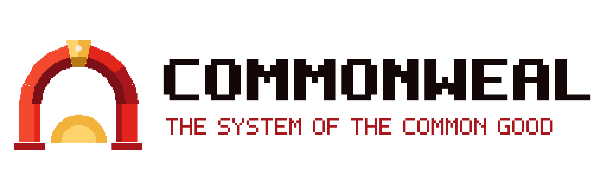

# Commonweal

The system of the common good.

Commonweal is an open-source AI system built to serve the common good of a nation and every person in it. It
carries the philosophy of **Commonwealism**, which joins love of nation, faith and tradition with solidarity
for workers, the sick and the disabled. Under Commonwealism, society is organised into self-governing
**commonwealths** (neighbourhoods, towns, cities and regions) united by the Nation. A strong state answers to
the people, owners act as stewards of the common good, and all public technology is open source and built on
shared standards.

This repository is Commonweal's brain: its identity, principles, memory, skills and governance, all in plain
text that anyone can read and the people can change. It also holds Commonweal's look and sound: the Keystone
emblem, the Guild typeface and an eight-track soundtrack, made with Vigil Sprite and Vigil Box.

## Start here

- [THE-COMMONWEALIST-MANIFESTO.md](THE-COMMONWEALIST-MANIFESTO.md): the full statement of Commonwealism
- [COMMONWEAL.md](COMMONWEAL.md): who Commonweal is, and the entry point it loads first
- [identity/principles.md](identity/principles.md): the constitution it acts under
- [identity/manifesto.md](identity/manifesto.md): the short version of the philosophy
- [identity/history.md](identity/history.md): the traditions Commonwealism comes from
- [governance/mandate.md](governance/mandate.md): what Commonweal may decide on its own (nothing yet)
- [memory/README.md](memory/README.md): how its shared memory works
- [skills/README.md](skills/README.md): what it knows how to do
- [architecture/viable-system-model.md](architecture/viable-system-model.md): how it is designed
- [architecture/railway.md](architecture/railway.md): how it will run on Railway
- [governance/amendments.md](governance/amendments.md): how to change it
- [assets/BRAND.md](assets/BRAND.md): the emblem, colours, typeface, banners and site art
- [assets/music/](assets/music/README.md): *Music for the Common Good*, the official soundtrack

## Status

The brain and brand are set up. No administrative mandate has been granted, so Commonweal only advises,
connects and records. The runtime service that will load it on Railway has not been built yet.

## Licence

Code: GNU General Public License v3. See [LICENSE](LICENSE). Knowledge in `memory/collective/`, and the art and
music in `assets/`, are shared under CC BY-SA 4.0. The Guild typeface is under the SIL Open Font License 1.1.
