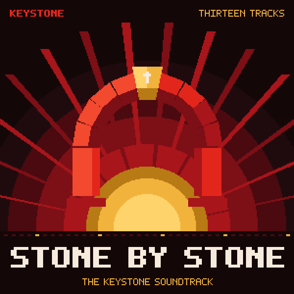

# Stone by Stone

The official soundtrack of Keystone and Christian Unionism: thirteen rock tracks, composed and rendered with
**Vigil Box**. Together they run about 28 minutes.

| # | Title | | Key | Tempo | Length |
|---|---|---|---|---|---|
| 1 | [Keystone](mp3/01-keystone.mp3) | Theme of Keystone | D minor | 112 | 2:11 |
| 2 | [Dignity](mp3/02-dignity.mp3) | Made in the image of God | E minor | 140 | 1:45 |
| 3 | [Shoulder to Shoulder](mp3/03-shoulder-to-shoulder.mp3) | Solidarity | A minor | 150 | 1:38 |
| 4 | [Cry of the Poor](mp3/04-cry-of-the-poor.mp3) | The first claim on our care | C minor to major | 96 | 2:22 |
| 5 | [Working Hands](mp3/05-working-hands.mp3) | Work is a vocation | G major | 132 | 1:58 |
| 6 | [Hearth and Home](mp3/06-hearth-and-home.mp3) | A waltz for the family | F major | 84 | 2:02 |
| 7 | [Free to Believe](mp3/07-free-to-believe.mp3) | Religious liberty for all | A major | 120 | 1:54 |
| 8 | [Handed Down](mp3/08-handed-down.mp3) | Tradition held in trust | E minor | 100 | 2:36 |
| 9 | [Town, District, Nation](mp3/09-town-district-nation.mp3) | Every level in its place | D minor | 72 | 2:57 |
| 10 | [Pilgrims](mp3/10-pilgrims.mp3) | Strangers made at home | D major | 116 | 1:58 |
| 11 | [Care for Creation](mp3/11-care-for-creation.mp3) | Stewards of the earth | E minor | 76 | 2:47 |
| 12 | [The Common Good](mp3/12-the-common-good.mp3) | Everyone's good, together | C major | 128 | 1:54 |
| 13 | [Stone by Stone](mp3/13-stone-by-stone.mp3) | Finale | D major | 112 | 2:02 |

## Notes on the tracks

1. **Keystone.** The main theme, for the stone that holds the arch. A guitar riff, then the theme low and steady, a chorus that lifts, a solo, and the theme again an octave higher with strings and organ behind it.
2. **Dignity.** Hard rock for the worth of every person, which no state, market or machine can take away. Twin distorted guitars, a galloping verse and a brass-backed chorus.
3. **Shoulder to Shoulder.** Fast, loud and together: a punk-rock anthem for solidarity, where the strong stand with the weak. Power chords all the way through, and a choir on every chorus.
4. **Cry of the Poor.** A tolling bell, a heavy guitar and a pipe organ. The poor cry out, and the cry goes straight to those who can answer. In the last section it is answered, and the music turns from C minor to C major.
5. **Working Hands.** Bright, driving rock with a Hammond-style organ and a brass section, for the dignity of work and a just wage. Every job done well builds the nation.
6. **Hearth and Home.** A power ballad in waltz time for the family, the first school of love. It begins with piano and acoustic guitar, then the strings come in and the electric guitar takes the melody home.
7. **Free to Believe.** An open-hearted anthem for religious liberty. Faith cannot be forced, so every faith, and none, is free. Ringing guitars, piano and a choir that keeps rising.
8. **Handed Down.** A heavy, rolling groove with a rock organ, for the customs, crafts and faith our parents gave us. We keep what is good and hand it on.
9. **Town, District, Nation.** One melody played as a round. The piano is the town; the strings answer a bar later, an octave lower, as the district; the guitar joins two bars later as the nation. Then the whole band rises together.
10. **Pilgrims.** Folk rock for newcomers who take up the nation's language, laws and customs and are welcomed as equals. Acoustic guitar and piano at first, then the band and strings join in.
11. **Care for Creation.** A slow, wide build for the earth we hold in trust for our children. Clean guitar and organ open it like a sunrise, and it ends with every instrument at full height.
12. **The Common Good.** A stadium anthem for the measure of every law and every institution: the good of the whole nation and of every person in it. Big riff, big chorus, brass and piano.
13. **Stone by Stone.** The Keystone theme returns in D major with the whole band, a pipe organ and a choir: the common good, built stone by stone.

## The band

Every track is played by a rock band: lead guitar, rhythm guitar, bass and a real drum kit, with keys (rock
organ, grand piano, pipe organ or tubular bells) and a layer of strings, brass, choir or organ. The sounds are
BeepBox's own instruments, kept in [../src/box/instruments.json](../src/box/instruments.json). Each track's
instruments are listed in `album.json`.

## Files

- `mp3/`: 256 kbps MP3s, 44.1 kHz stereo, tagged with titles, track numbers and cover art.
- `album.json`: the track list with keys, tempos, lengths and instruments, for players and the website.
- `keystone-soundtrack-cover-3000.png` (streaming services) and `-600.png` (web and tags).
- `../src/box/*.song.json`: every track as an editable Vigil Box song. Open one in Vigil Box to change it.
- `wav/` (not in git): 16-bit WAV masters. Regenerate them with [tools/studio](../../tools/studio/README.md).

**Mastering:** each track is matched to −14 dBFS RMS, with soft-knee limiting that keeps peaks under −1 dBFS,
so the album plays at an even level.

## How it was made

The melodies and guitar solos were written note by note. The rhythm guitar's power chords come from each
section's chords and a strumming pattern (chug, gallop, push, stab), and Vigil Box's song tools generated the
bass, keys, layer and drum parts. Every track was balanced against Vigil Box's own per-channel audio analysis
and rendered with its BeepBox synth. The score is code in [tools/studio/music.js](../../tools/studio/music.js),
so anyone can read, change and re-render it.

## Licence

*Stone by Stone* by the Keystone contributors is shared under [Keystone License 1.0](../../LICENSE). Play it,
remix it, share it, and credit Keystone under its terms. See [LICENSING.md](../../LICENSING.md). Vigil Box is
built on BeepBox by John Nesky (MIT), whose instruments these are, and uses lamejs (LGPL) for MP3 encoding.
